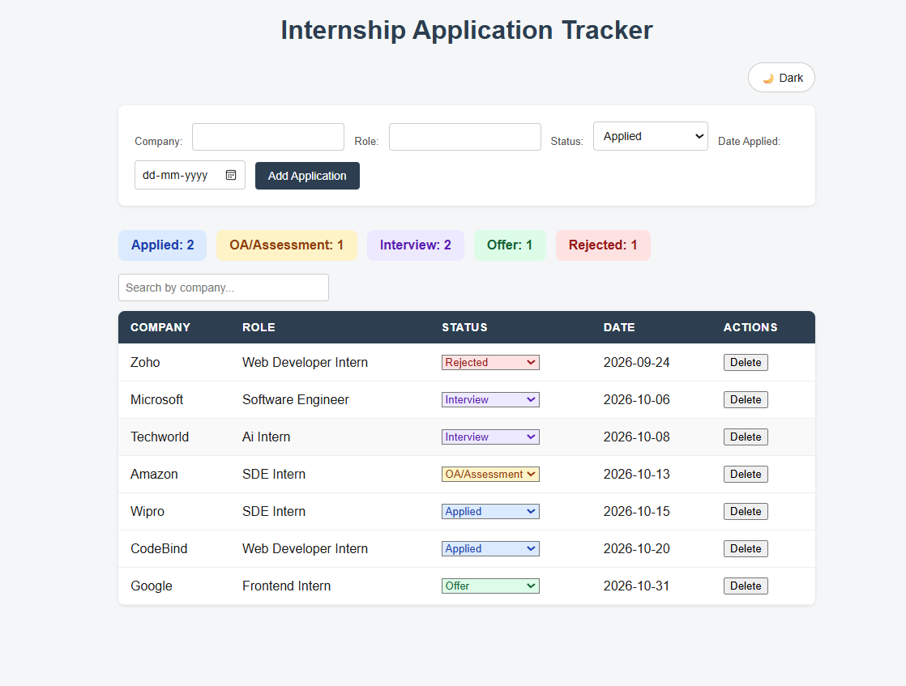
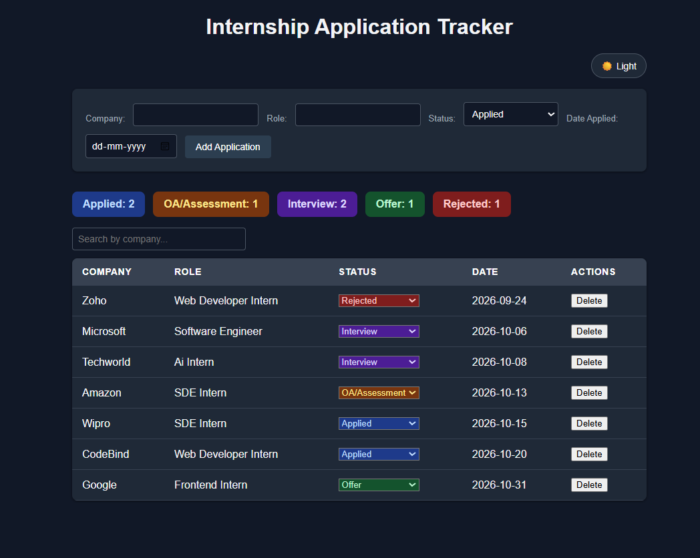

# Internship Application Tracker

A full-stack web app to track internship applications from first application to final offer.

**Live demo:** https://internship-application-tracker.netlify.app

> The backend runs on Render's free tier and sleeps when idle, so the first load can take up to about a minute. The page shows a "waking up" message while it starts.

## Screenshots

| Light mode | Dark mode |
|---|---|
|  |  |

## Features

- Add, view and delete applications (company, role, status, date applied)
- Update an application's status from a dropdown
- Five statuses with colour coding: Applied, OA/Assessment, Interview, Offer, Rejected
- Summary cards showing how many applications are in each status
- Search by company name (case-insensitive)
- Dark and light theme toggle, remembered in the browser
- Loading message while the free-tier server wakes up

## Tech Stack

| Layer | Technology |
|---|---|
| Frontend | HTML, CSS, vanilla JavaScript |
| Backend | Node.js, Express |
| Database | MongoDB Atlas |
| Hosting | Netlify (frontend), Render (backend) |

## How it works

```
Browser (Netlify) --fetch--> Express API (Render) --> MongoDB Atlas
```

The frontend calls a REST API. The API reads and writes applications in MongoDB. CORS is restricted so only the deployed frontend and local development addresses can call the API from a browser.

## Run locally

1. Clone the repo
2. Backend:
   ```
   cd backend
   npm install
   ```
   Create a `.env` file in `backend/` with your own `MONGO_URI`, then run `npm start`.
3. Frontend: open `frontend/index.html` with VS Code Live Server (port 5500). Set `API_URL` in `frontend/js/script.js` to `http://localhost:3000/applications` to use your local backend.

## Known limitations

- No user login yet, so anyone with the API URL could change data. CORS only restricts browsers, not other clients.
- Only the status can be edited. To fix a typo, delete the entry and add it again.

## Future improvements

- User authentication (email OTP)
- Edit all fields of an application
- Deadline reminders